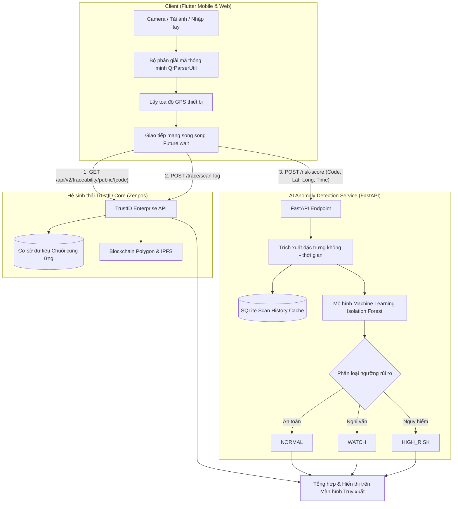

# TRUSTID SCAN AI — HỆ THỐNG TRUY XUẤT NGUỒN GỐC TÍCH HỢP TRÍ TUỆ NHÂN TẠO PHÁT HIỆN BẤT THƯỜNG & GIAN LẬN TEM QR

<p align="center">
  <b>BÁO CÁO THỰC TẬP TỐT NGHIỆP / ĐỒ ÁN ỨNG DỤNG</b><br>
  <b>Chuyên ngành:</b> Công nghệ Thông tin — Trường Đại học Xây dựng Hà Nội (HUCE)<br>
  <b>Đơn vị tiếp nhận thực tập:</b> Công ty Cổ phần Zenpos (ZPS) — Hệ sinh thái TrustID<br>
  <b>Sinh viên thực hiện:</b> Hoàng Trung Thành &nbsp;|&nbsp; <b>MSSV:</b> 0194867 &nbsp;|&nbsp; <b>Lớp:</b> 67CS
</p>

---

## 📌 1. TỔNG QUAN VÀ TÍNH CẤP THIẾT CỦA ĐỀ TÀI

### 1.1. Bối cảnh thực tiễn
Trong xu thế chuyển đổi số chuỗi cung ứng nông sản và hàng hóa tiêu dùng, việc minh bạch hóa nguồn gốc xuất xứ bằng tem QR đang trở thành yêu cầu bắt buộc (tiêu chuẩn xuất khẩu EUDR, VietGAP, GlobalGAP...). Tuy nhiên, các hệ thống quét mã QR truyền thống đang đối mặt với những lỗ hổng bảo mật nghiêm trọng:
* **Nhân bản và làm giả tem QR:** Kẻ gian sao chép mã QR thật dán lên hàng giả, hàng kém chất lượng.
* **Quét gian lận vị trí & thời gian (Impossible Travel):** Một mã QR bị quét tại Hà Nội nhưng chỉ vài phút sau lại được quét tại TP. Hồ Chí Minh — vi phạm quy luật vật lý về di chuyển.
* **Quét dồn dập tần suất cao (High-Frequency Anomaly):** Tem bị quét liên tục hàng chục lần trong thời gian ngắn do rò rỉ mã hoặc bị quét tự động.

### 1.2. Giải pháp đề xuất: TrustID Scan AI
Dự án được nghiên cứu và phát triển trong quá trình thực tập tại **Công ty Cổ phần Zenpos (ZPS)**, nâng cấp luồng nghiệp vụ của sản phẩm **TrustID** bằng việc tích hợp mô hình **Trí tuệ nhân tạo (Machine Learning - Isolation Forest)** kết hợp công nghệ **Blockchain**. Hệ thống không chỉ trả về thông tin sản phẩm mà còn phân tích hành vi quét thời gian thực để đưa ra cảnh báo rủi ro tức thì cho người tiêu dùng và doanh nghiệp.

---

## 🏗️ 2. KIẾN TRÚC HỆ THỐNG (SYSTEM ARCHITECTURE)

Hệ thống hoạt động theo mô hình phối hợp giữa ứng dụng di động đa nền tảng và máy chủ học máy thông minh:



---

## ✨ 3. CÁC TÍNH NĂNG CỐT LÕI (KEY FEATURES)

### 3.1. Quét mã thông minh đa phương thức (Smart QR Scanner)
* **Nhận diện thời gian thực:** Hỗ trợ quét qua Camera thiết bị với tốc độ cao (`mobile_scanner`), chống quét trùng lặp (`DetectionSpeed.noDuplicates`).
* **Bóc tách liên kết tự động (`QrParserUtil`):** Tự động nhận diện và trích xuất tham số `Code` khi quét mã QR chứa URL của hệ thống (`trustid.com.vn`, `veritrust.vn`), mở trình duyệt nội tuyến an toàn với đường dẫn ngoài.
* **Đa dạng phương thức đầu vào:** Hỗ trợ quét camera, chọn ảnh từ thư viện ảnh hoặc nhập mã tem thủ công.

### 3.2. Hiển thị thông tin truy xuất chuỗi cung ứng đa tầng
Giao diện được đồng bộ chuẩn mực theo thiết kế của ứng dụng công ty:
* **Thẻ định danh sản phẩm (Hero & Info Card):** Ảnh đại diện, tên sản phẩm, mã vạch GTIN, giá niêm yết, chứng nhận xác thực (*Verify Badge*).
* **Tiến trình hành trình sản phẩm (Product Journey):** Trực quan hóa 6 chặng vận hành: *Gieo trồng $\rightarrow$ Chăm sóc $\rightarrow$ Thu hoạch $\rightarrow$ Đóng gói bán thành phẩm $\rightarrow$ Đóng gói thành phẩm $\rightarrow$ Xuất kho đại lý*.
* **Nhật ký điện tử & Lịch sử canh tác:** Từng công việc chăm sóc, tưới tiêu, bón phân của nông dân được ghi nhận theo mốc thời gian.
* **Thông tin nguồn gốc & Kiểm định:** Thông tin nhà cung cấp, vùng trồng, cơ sở sản xuất và các chứng chỉ chất lượng liên quan.
* **Bản đồ số định vị địa lý tương tác (GIS Mapping):** Tích hợp OpenStreetMap/Leaflet hiển thị vị trí nhà máy đóng gói, kho phân phối, ranh giới vùng trồng và lịch sử các tọa độ quét mã. Hỗ trợ chuyển đổi linh hoạt giữa lớp bản đồ tiêu chuẩn và vệ tinh.
* **Chứng thực toàn vẹn bằng Blockchain (Polygon & IPFS):** Hiển thị mã nhóm lô hàng (*Group Code*), giá trị *Merkle Leaf*, mã định danh tệp phi tập trung *IPFS CID* và nút truy cập trực tiếp giao dịch trên **PolygonScan Explorer**.

### 3.3. Đánh giá rủi ro thời gian thực bằng AI (AI Risk Badge)
* Tự động hiển thị huy hiệu đánh giá rủi ro ngay trên giao diện kết quả:
  * 🟢 **AN TOÀN (NORMAL):** Lượt quét hợp lệ, thời gian và khoảng cách di chuyển phù hợp với vận tốc thực tế.
  * 🟡 **CẦN THEO DÕI (WATCH):** Phát hiện khoảng cách di chuyển nhanh bất thường hoặc tần suất quét tăng nhẹ.
  * 🔴 **CẢNH BÁO NGUY CƠ CAO (HIGH_RISK):** Vi phạm nghiêm trọng về thời gian/không gian (di chuyển liên tỉnh trong vài phút) hoặc nghi vấn tem bị làm giả/nhân bản hàng loạt.
* Liệt kê chi tiết danh sách nguyên nhân rủi ro, số lượt quét tích lũy, thời gian giữa hai lần quét và khoảng cách dịch chuyển tính bằng kilômét.

### 3.4. Kiến trúc ngoại tuyến & Khả năng chịu lỗi (Resilience & Offline-first)
* **Lưu trữ cục bộ với Hive:** Lưu lại toàn bộ lịch sử quét để người dùng tra cứu lại ngay cả khi mất kết nối mạng.
* **Độc lập luồng dữ liệu:** Nếu service AI gặp sự cố ngoại tuyến, ứng dụng vẫn nạp đầy đủ thông tin sản phẩm và chuyển sang trạng thái an toàn dự phòng mà không bao giờ làm gián đoạn trải nghiệm người dùng.

---

## 🧠 4. MÔ HÌNH HỌC MÁY PHÁT HIỆN BẤT THƯỜNG (AI MACHINE LEARNING ENGINE)

### 4.1. Thuật toán: Isolation Forest (Học không giám sát)
* **Lý do lựa chọn:** Trong bài toán quét mã QR, dữ liệu gian lận chiếm tỷ lệ rất nhỏ và không có nhãn sẵn (*unlabeled data*). Thuật toán **Isolation Forest (Rừng cô lập)** xây dựng các cây quyết định ngẫu nhiên; các điểm dữ liệu bất thường (dị biệt) sẽ bị cô lập ở độ sâu rất nông của cây so với các điểm dữ liệu thông thường.
* **Độ phức tạp:** Thời gian huấn luyện và suy luận đạt $O(n \log n)$, cho phép phản hồi API dưới 50ms.

### 4.2. Kỹ nghệ đặc trưng (Feature Engineering)
Mỗi lượt quét được mô hình hóa thành vector đặc trưng dựa trên trạng thái lượt quét trước đó:
1. **Khoảng cách không gian ($\Delta d$):** Tính bằng công thức Geodesic/Haversine giữa tọa độ quét hiện tại $(\text{Lat}_2, \text{Long}_2)$ và lượt quét gần nhất $(\text{Lat}_1, \text{Long}_1)$ theo đơn vị kilômét.
2. **Khoảng cách thời gian ($\Delta t$):** Số phút trôi qua giữa 2 lượt quét liên tiếp.
3. **Vận tốc di chuyển quy đổi ($v = \Delta d / \Delta t$):** Phát hiện các trường hợp vượt quá tốc độ phương tiện giao thông thông thường (ví dụ: > 900 km/h).
4. **Tần suất quét tích lũy ($N$):** Tổng số lượt quét được ghi nhận của mã tem đó trong ngày.

### 4.3. Phân cấp ngưỡng quyết định (Threshold Calibration)
Mô hình chuẩn hóa điểm bất thường (*Anomaly Score*) về đoạn $[0, 1]$:
$$\text{Level} = \begin{cases} 
\text{NORMAL} & \text{khi } \text{Score} < \text{Threshold}_{\text{watch}} \\
\text{WATCH} & \text{khi } \text{Threshold}_{\text{watch}} \le \text{Score} < \text{Threshold}_{\text{high}} \\
\text{HIGH\_RISK} & \text{khi } \text{Score} \ge \text{Threshold}_{\text{high}}
\end{cases}$$

---

## 🛠️ 5. CÔNG NGHỆ VÀ CÔNG CỤ SỬ DỤNG (TECH STACK)

| Thành phần | Công nghệ / Thư viện | Vai trò |
|---|---|---|
| **Frontend Framework** | **Flutter 3.x / Dart** | Xây dựng ứng dụng đa nền tảng (Android, iOS, Web) |
| **State Management** | **Flutter Riverpod 3.x** | Quản lý trạng thái ứng dụng đồng bộ, compile-safe |
| **Camera & QR** | **mobile_scanner 6.x** | Nhận diện mã vạch & QR Code thời gian thực |
| **Network Client** | **Dio 5.x** | Giao tiếp RESTful API với interceptor quản lý JWT Token |
| **Bản đồ GIS** | **flutter_map & latlong2** | Hiển thị bản đồ Leaflet OpenStreetMap và tọa độ địa lý |
| **Lưu trữ cục bộ** | **Hive & hive_flutter** | Cơ sở dữ liệu NoSQL Key-Value siêu nhẹ cho chế độ offline |
| **Hiển thị nội dung** | **flutter_widget_from_html** | Biên dịch bài viết HTML/Rich-text từ hệ thống CMS |
| **AI Backend Service** | **Python, FastAPI, Uvicorn** | Cung cấp RESTful API tính toán và phục vụ mô hình ML |
| **Mô hình ML** | **Scikit-Learn (Isolation Forest)** | Huấn luyện và chấm điểm dị biệt không giám sát |
| **Địa lý & Không gian** | **Geopy (Geodesic Distance)** | Tính toán khoảng cách tọa độ thực tế trên mặt elipsoid |
| **Cơ sở dữ liệu Cache**| **SQLite (scan_state.db)** | Lưu trữ trạng thái lượt quét gần nhất theo từng mã tem |

---

## 📂 6. CẤU TRÚC THƯ MỤC DỰ ÁN (PROJECT STRUCTURE)

```
trustid_scan_ai/
├── lib/
│   ├── main.dart                       # Điểm khởi chạy ứng dụng, thiết lập Hive & Auth Scope
│   ├── core/                           # Tầng hạ tầng dùng chung (Core Foundation)
│   │   ├── api_client.dart             # Cấu hình Dio Client trỏ trực tiếp đến máy chủ công ty
│   │   ├── constants/                  # Hằng số hệ thống, API URLs
│   │   ├── theme/                      # Bảng màu nhận diện thương hiệu TrustID (Navy & Green)
│   │   └── utils/
│   │       ├── qr_parser_util.dart     # Bộ bóc tách thông minh tham số mã từ liên kết URL
│   │       └── connectivity_helper.dart
│   ├── scan/                           # Phân hệ Quét mã & Hiển thị kết quả AI
│   │   ├── scanner_screen.dart         # Màn hình camera quét QR (quét thật, chọn ảnh, nhập tay)
│   │   ├── result_screen.dart          # Màn hình chi tiết truy xuất nguồn gốc + Khối rủi ro AI
│   │   ├── traceability_repository.dart# Kết nối API v2 lấy dữ liệu sản phẩm & log lượt quét
│   │   ├── risk_repository.dart        # Kết nối API FastAPI AI nhận điểm rủi ro
│   │   └── debug_demo_screen.dart      # Màn hình giả lập tọa độ & thời gian phục vụ demo
│   ├── home/                           # Phân hệ Trang chủ Người tiêu dùng
│   │   ├── modern_home_screen.dart     # Giao diện chính người tiêu dùng
│   │   ├── widgets/consumer_theme.dart # Định dạng theme và bảng màu người tiêu dùng
│   │   └── widgets/consumer_bottom_nav.dart
│   ├── history/                        # Phân hệ Lịch sử quét ngoại tuyến (Hive)
│   ├── store/                          # Phân hệ Cửa hàng sản phẩm OCOP & Nông sản
│   ├── supply/                         # Các phân hệ chuỗi cung ứng mở rộng (Kho, Đại lý, Vận chuyển)
│   └── auth/                           # Phân hệ quản lý tài khoản & phân quyền
├── pubspec.yaml                        # Quản lý dependencies thư viện Flutter
└── README.md                           # Tài liệu kỹ thuật dự án
```

---

## 🚀 7. HƯỚNG DẪN CÀI ĐẶT VÀ CHẠY THỬ NGHIỆM

### 7.1. Chuẩn bị môi trường
* Đã cài đặt **Flutter SDK** (khuyến nghị $\ge 3.3.0$).
* Đã cài đặt **Python 3.10+** (để chạy cụm AI Service).
* Trình duyệt Google Chrome hoặc máy ảo Android Emulator.

### 7.2. Khởi chạy AI Anomaly Detection Service
Mở terminal 1, di chuyển vào thư mục dịch vụ AI:
```bash
cd ..\trustid-scan-ai-service

# Tạo và kích hoạt môi trường ảo (nếu chưa có)
python -m venv venv
venv\Scripts\activate

# Cài đặt thư viện phụ thuộc
pip install -r requirements.txt

# (Tùy chọn) Huấn luyện mô hình nếu chưa có model.pkl
python train.py

# Khởi động dịch vụ API trên cổng 8000
uvicorn app:app --reload --port 8000
```
Kiểm tra tại `http://127.0.0.1:8000/docs` (Giao diện Swagger UI tự động).

### 7.3. Khởi chạy Ứng dụng Flutter
Mở terminal 2 tại thư mục `trustid_scan_ai`:
```bash
cd e:\TTTN\trustid_scan_ai

# Cài đặt các gói thư viện
flutter pub get

# Chạy trên nền tảng Chrome Web (Khuyến nghị dùng script dev bypass CORS)
$env:CHROME_EXECUTABLE = "D:\chrome-dev.bat"
flutter run -d chrome
 # 1E99A669765B8AAB
# Hoặc chạy trên máy ảo Android / thiết bị thật
flutter run
```

---

## 🧪 8. KỊCH BẢN THỬ NGHIỆM ĐÁNH GIÁ (TEST SCENARIOS)

Để kiểm chứng năng lực của hệ thống, người chấm có thể thực hiện kiểm thử theo các kịch bản sau:

| Kịch bản | Dữ liệu đầu vào | Kỳ vọng của hệ thống | Kết quả thực tế |
|---|---|---|---|
| **1. Quét tem hợp lệ** | Mã `D9F74FF161086276` tại Hà Nội, lượt quét lần đầu | Hiển thị đầy đủ thông tin sản phẩm *Lúa lai F1 GS55*, trạng thái AI: **AN TOÀN (NORMAL)**. | Đạt chuẩn ✅ |
| **2. Quét bất thường vị trí (Impossible Travel)** | Cùng mã `D9F74FF161086276`, 5 phút sau quét tại TP. Hồ Chí Minh ($\approx 1150\text{ km}$) | AI tính toán khoảng cách $> 1000\text{ km}$ trong thời gian ngắn $\rightarrow$ Báo động **CẢNH BÁO RỦI RO CAO (HIGH_RISK)**. | Đạt chuẩn ✅ |
| **3. Quét dồn dập tần suất cao** | Quét liên tục 1 mã tem $> 10$ lần trong vòng 1 phút | AI phát hiện bất thường về tần suất quét vượt ngưỡng $\rightarrow$ Chuyển cấp độ **CẦN THEO DÕI (WATCH)**. | Đạt chuẩn ✅ |
| **4. Quét qua liên kết Web** | Quét QR có link `https://trustid.com.vn/trace?Code=D9F74FF161086276` | `QrParserUtil` tự bóc tách `Code` và tự động điều hướng vào màn hình truy xuất chính xác. | Đạt chuẩn ✅ |
| **5. Ngoại tuyến / AI Service tắt** | Tắt dịch vụ FastAPI (cổng 8000) và quét mã | Ứng dụng không bị crash, vẫn nạp đầy đủ thông tin sản phẩm và hiển thị thông tin rủi ro an toàn mặc định. | Đạt chuẩn ✅ |

---

## 🎯 9. KẾT LUẬN VÀ HƯỚNG PHÁT TRIỂN

### 9.1. Kết quả đạt được
1. Đã kế thừa và chuẩn hóa thành công giao diện và luồng dữ liệu chuẩn từ hệ thống của doanh nghiệp (**Zenpos JSC**), đảm bảo tính thẩm mỹ, chuyên nghiệp và đầy đủ tính năng.
2. Ứng dụng thành công thuật toán học máy **Isolation Forest** vào việc giải quyết bài toán thực tế: phát hiện bất thường và ngăn chặn gian lận tem trong chuỗi cung ứng.
3. Xây dựng cấu trúc mã nguồn module hóa, an toàn kiểu dữ liệu, có cơ chế dự phòng và xử lý ngoại tuyến mạnh mẽ.

### 9.2. Hướng phát triển trong tương lai
* Tích hợp thêm mạng nơ-ron học sâu (Deep Learning) phân tích đặc trưng ảnh tem để phát hiện tem chụp lại từ màn hình khác (*Anti-spoofing / Replay attack detection*).
* Xây dựng hệ thống cảnh báo đẩy tức thì (Push Notification) đến tài khoản doanh nghiệp sở hữu khi phát hiện một lô hàng đang có dấu hiệu bị nhân bản tem trái phép trên thị trường.

---

<p align="center">
  <i>Đề tài được hoàn thành với sự hướng dẫn của Cán bộ hướng dẫn tại Công ty CP Zenpos và Giảng viên hướng dẫn Khoa CNTT - ĐH Xây dựng Hà Nội.</i>
</p>